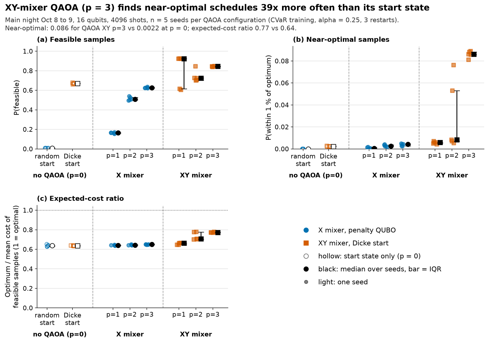
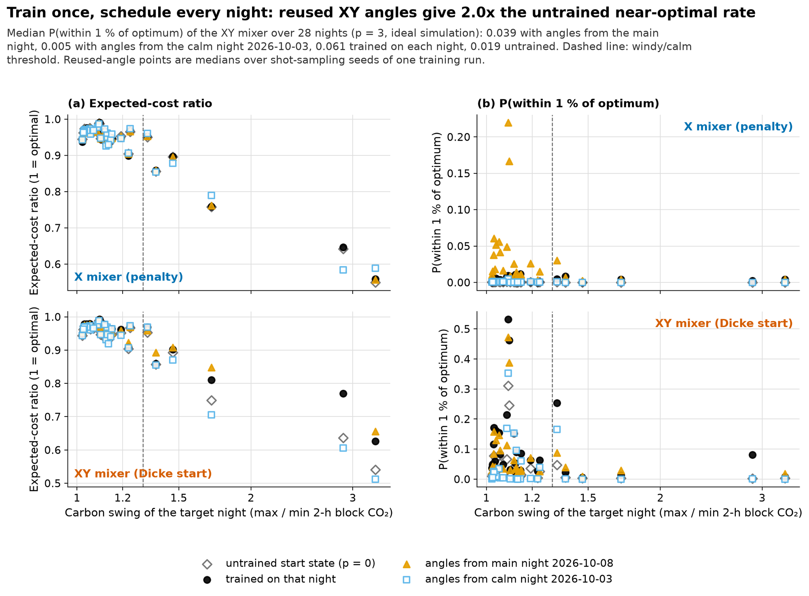

# Carbon-aware charging for an electric bus depot

**At a glance**

- **The problem:** Dutch bus depots are electrifying fast and running out of grid capacity; we schedule overnight e-bus charging against the grid's real carbon intensity and prices.
- **Real data:** one full year of measured Dutch grid data (362 nights, Energy-Charts), a 100-bus depot modelled on public figures.
- **Impact (classical optimizer):** **252 t less CO₂ and €124,000 lower energy cost per year** on the same grid connection, and the whole fleet charges on **3.3 MW instead of 6.9 MW**.
- **Quantum encoding:** the constraint-preserving XY-mixer QAOA finds near-optimal schedules **39× more often** than its starting state on 16-qubit problems.
- **Real IonQ hardware:** one trained circuit ran on **IonQ's Forte 1 quantum computer** and matched our noise-model prediction within one standard error.
- **Hybrid quantum-classical:** inside the 100-bus depot optimizer, QAOA re-plans two buses at a time and gets the depot within about 0.5 % of exact enumeration.
- **Train once, schedule every night:** QAOA angles trained on one night **doubled** the near-optimal rate on 28 other nights.

Dutch bus operators are moving their whole fleets to electric, and many depots are running into the limits of their grid connection. We schedule the overnight charging of a 100-bus depot against the grid's real carbon intensity and day-ahead prices, using one full year of measured Dutch grid data. A classical optimizer plans the whole depot. QAOA, written in Qiskit, is tested as its subproblem solver, and one trained circuit ran on IonQ hardware.

**Results for one year (362 nights) from the classical optimizer, carbon-first schedule:**

- **252 t less CO₂ (−5.0 %) and €124,000 lower energy cost (−8.2 %)** than unmanaged charging, on the same 6.9 MW grid connection.
- **200 t less CO₂ and €90,000 lower cost** than simple first-come-first-served charging on its 5.4 MW connection.
- **3.3 MW is enough** to charge every bus in time, against 5.4 MW with first-come-first-served capping and 6.9 MW unmanaged.

**The quantum part:**

- **XY encoding works:** on 16-qubit scheduling problems, the constraint-preserving XY-mixer QAOA puts **39 times more probability** on near-optimal schedules than its starting state.
- **Validated on hardware:** one trained circuit ran on **IonQ's Forte 1 quantum computer** and landed within one standard error of what our noise model predicted.
- **Works inside the real-scale optimizer:** in the depot optimizer, QAOA (simulated) re-plans two buses at a time (up to 16 qubits) and gets the depot within about 0.5 % of what exact enumeration of those subproblems reaches.

[The problem](#the-problem) · [How it works](#how-it-works) · [Results](#results) · [Related work](#related-work-and-whats-new) · [Run it](#run-it) · [Data and license](#data-and-license)

Built for the Qollab × IonQ Quantum Hackathon (Oct 9–11, 2026), theme **Quantum Impact**.

## The problem

A bus depot parks its electric buses overnight and has to charge all of them by the morning. If every bus starts charging as soon as it returns, the load piles up in the evening, often the dirtiest and most expensive hours of the night, and the depot needs a large grid connection to cover the peak. The question we answer is **which bus should charge in which hour**, between 20:00 and 08:00, so that every bus is ready in time, the depot stays under its connection limit, and the night's charging emits as little CO₂ as possible.

This matters in the Netherlands right now. The country had about 2,748 zero-emission buses in 2025, and new public-transport buses must be zero-emission ([Sustainable Bus](https://www.sustainable-bus.com/news/netherlands-zero-emission-buses-2025/)). Grid congestion has already pushed some operators back to diesel, such as Arriva in Roosendaal and EBS in Flevoland ([Sustainable Bus](https://sustainable-bus.com/news/netherlands-transition-electric-buses-grid-issues)). Smarter charging has a track record here: Transdev and Liander reduced the 10 MVA connection of the Amstelveen depot after moving to smarter charging ([Sustainable Bus](https://sustainable-bus.com/infrastructure/transdev-liander-charging-capacity-electric-buses)). We add a carbon-aware objective, evaluated night by night over a full year of measured carbon and price data.

The depot is modelled on public figures:
- **Fleet:** 100 e-buses, the size of the Amstelveen/Schiphol fleet ([electrive](https://www.electrive.com/2018/03/28/extra-large-13-mw-charge-depot-for-100-e-buses-live-in-amsterdam)).
- **Energy use:** measured Dutch values of 1.15 and 1.63 kWh/km for 12 m and 18 m buses ([Sustainable Bus](https://sustainable-bus.com/wp-json/wp/v2/posts/10542)).
- **Daily distance:** about 265 km per bus ([EVConsult](https://www.LowCVP.org.uk/assets/presentations/6._EVBus_Rollout_Experiences_from_NL-BIbiFabius_EVConsult.pdf)).
- **Our own choices:** 100 kW chargers, buses returning between 20:00 and 00:00 and leaving between 05:00 and 07:00.

Together the buses need 34.7 MWh per night (`carbon_ev/depot.py`, `results/e7_depot_year.csv`).

## How it works

![Flow diagram. Top row, the classical pipeline: one year of Dutch grid data feeds a depot model of 100 e-buses with a grid-connection limit; a classical MILP optimizer schedules the whole depot and produces the yearly results. Bottom row, the quantum subroutine: a hybrid search frees two buses at a time and turns their hours into a QUBO of at most 16 qubits, QAOA in Qiskit with an XY mixer and Dicke start solves it, sampled on a statevector simulator (one trained circuit also ran on IonQ Forte 1 hardware), and the best sample goes back into the depot schedule if it improves it. The quality of this search is measured against the classical optimum.](assets/pipeline.png)

**Data.** We use hourly carbon intensity and day-ahead prices for the Netherlands from Energy-Charts, from 10 October 2025 to 9 October 2026, 362 complete nights (`data/`).

**The classical optimizer.** Each night is twelve one-hour blocks. A mixed-integer program (MILP, solved with SciPy's HiGHS) decides for every bus and every hour whether it charges. Every bus must get its energy before it leaves, and the depot's total power must stay under the connection limit. The objective weighs carbon and price; our headline uses the carbon-first setting, w = 1. We compare against two baselines: unmanaged charging, where every bus charges on arrival, and first-come-first-served charging under a capped connection. The yearly results come from this optimizer.

**The quantum subroutine.** Scheduling is a yes/no decision per bus and hour, so it maps naturally onto a QUBO and onto QAOA. We use it in two ways:

- **Inside the depot (e8).** A large-neighbourhood search keeps all buses fixed except two. Their hours become a QUBO of at most 16 qubits, and QAOA proposes a new plan for them. The plan is accepted if it improves the depot schedule, and the search moves on to the next pair.
- **On 16-qubit benchmark problems (e1–e6).** Three vehicles over six 2-hour blocks give one qubit per decision. Here we compare two ways of encoding the "each vehicle gets exactly k blocks" rule. A *penalty* QUBO uses the standard X mixer. The *XY mixer* keeps the number of charging blocks per vehicle fixed and starts from a Dicke state, so every sample already meets that rule. The angles are trained with a CVaR objective (Barkoutsos et al., [Quantum 4, 256 (2020)](https://doi.org/10.22331/q-2020-04-24-256)), and we always compare QAOA with its own untrained starting state.

The full formulation, the training settings and every table are in [docs/technical_notes.md](docs/technical_notes.md).

## Results

In short:

- **252 t CO₂ and €124,000 saved per year** at a 100-bus depot, on the same grid connection (classical optimizer, 362 real nights).
- **3.3 MW instead of 6.9 MW** of grid connection for the same fleet.
- **39× more near-optimal schedules** from XY-mixer QAOA than from its starting state.
- **IonQ Forte 1 hardware matched our noise-model prediction** within one standard error.
- **QAOA as a subsolver** inside the depot optimizer gets within about 0.5 % of exact enumeration.
- **Angles trained once** doubled the near-optimal rate on 28 other nights.

### A year of smart charging at the depot


Over 362 nights the smart schedule saves **252 t of CO₂ and €124,000** of wholesale energy cost against unmanaged charging, on the same 6.9 MW connection. Unmanaged charging emits 5,019 t and costs €1.51 million over the year. Windy nights carry most of the saving: 180 of the 252 t come from the 127 nights on which carbon intensity swings by at least 1.3× through the night, and on those nights the depot emits 13.6 % less. The savings show up in every month.

The same schedule also needs far less grid. Every bus still charges in time on a **3.31 MW** connection, 52 % below the unmanaged peak of 6.90 MW and well below the 5.40 MW that first-come-first-served capping needs.

If an operator values money more, a cost-balanced weight (w = 0.7) saves **€194,000 (12.9 %) and 217 t of CO₂** per year. "Per year" means the 362 nights of the dataset. Source: `results/e7_summary.csv`.

### XY-mixer QAOA concentrates on near-optimal schedules



On the windy night of 8–9 October, the XY-mixer QAOA with three layers samples a schedule within 1 % of the optimum with probability 0.086, against 0.0022 for its untrained Dicke starting state, **39 times more often**. The average quality of its valid schedules rises from 0.64 to 0.77 of the optimum. 84 % of its samples are valid schedules, against 62 % for the penalty encoding (`results/e1_summary.csv`, five seeds).

### On IonQ Forte 1 hardware, the result matched our prediction

We trained the XY circuit (p = 2, 16 qubits) on the simulator and ran it once on **IonQ's Forte 1 quantum computer** through Qollab, with 1,000 shots. Before the run, we had predicted its behaviour with a noise model built only from IonQ's published error rates.

| Same circuit | Valid schedules | Quality of valid schedules |
|---|---|---|
| Ideal simulator | 0.71 | 0.70 |
| Our IonQ-like noise model | 0.33 | 0.69 |
| **IonQ Forte 1 (hardware)** | **0.32 ± 0.015** | **0.69** |

The hardware lands within about one standard error of the prediction. Noise roughly halves the share of valid samples, while the valid schedules keep their quality. Sources: `results/e9_forte1_hardware_check.csv` and the console output in `results/qollab_ionq_forte1_hardware.txt`.


### QAOA as a subsolver inside the 100-bus depot


Here QAOA works on the modelled 100-bus depot itself. Starting from the first-come-first-served schedule (12,321 kg CO₂ on the windy night), the search hands QAOA two buses at a time. **With QAOA as the subsolver, the depot gets 97–99 % of the way to the classical optimum (7,495 kg)**, on par with exact enumeration of the same subproblems: per seed, the final depot CO₂ is within about 0.5 % of the exact-enumeration run (two QAOA seeds, three exact seeds; `results/e8_summary.csv`). The interface is a single sampler call, so the same loop can use any Qiskit backend.

### Train once, schedule every night



A depot needs a new schedule every evening, and retraining QAOA every night is costly. We trained the angles once, on the main night, and reused them unchanged on 28 other nights. For the XY mixer, the reused angles **doubled the near-optimal sampling rate** of the untrained start (median 0.039 against 0.019, with 0.061 when retrained every night) and improved the average quality on all 28 nights (`results/e4_summary.csv`).

More results are in [docs/results_detail.md](docs/results_detail.md):
- **e2:** the 16-qubit problem on all 362 nights.
- **e5:** the carbon/cost trade-off on the 16-qubit problem. With carbon-first weighting, no night emits more CO₂ than charging on arrival.
- **e6:** scaling to 20 qubits.

## Related work and what's new

Carbon-aware and peak-aware e-bus charging is well established with classical methods:
- **Rupp et al.** charge e-buses against variable prices and CO₂ intensity, saving up to 13.6 % in cost and 14.9 % in CO₂ (Transportation Research Part D 81, 102293, 2020).
- **Brinkel et al.** study three Dutch Qbuzz depots (Transportation Research Part E 172, 103085, 2023).
- **Winschermann et al.** schedule a real Dutch bus charging site for emissions and peak, cutting the peak by up to 57 % ([arXiv 2504.06078](https://arxiv.org/abs/2504.06078)).

Our cost saving (12.9 % at w = 0.7) and connection reduction (52 %) sit in the same range as these studies.

On the quantum side:
- **Yu and Nabil** used quantum annealing for e-bus charging cost ([Frontiers in Physics 9, 730685, 2021](https://www.frontiersin.org/articles/10.3389/fphy.2021.730685/full)).
- QAOA has been applied to EV charging by **Dalyac et al.** (EPJ Quantum Technology 8, 12, 2021), **Kea, Huot and Han** ([IEEE Access 11, 109964, 2023](https://doi.org/10.1109/ACCESS.2023.3320800)), **Ekstrøm, Wang and Schmitt** ([arXiv 2605.10255](https://arxiv.org/abs/2605.10255)), **Sturm et al.** ([arXiv 2404.07171](https://arxiv.org/abs/2404.07171)) and a [TJHSST QLab student project](https://qlab.sites.tjhsst.edu/projects/detail/97/).
- XY mixers and Dicke states are established tools.

We did not find prior work that applies QAOA to EV or bus charging against a measured grid carbon and price signal, or that pairs such a benchmark with a full-year, depot-scale evaluation. What this project adds:
- the **penalty-versus-XY encoding comparison** on this problem, including its behaviour under noise;
- **QAOA as a working subsolver** inside a depot-scale optimizer;
- **reusing trained angles across nights;**
- a **noise model checked against IonQ Forte 1 hardware**.

## Assumptions

- **Fleet:** the depot is modelled on public figures, not on a specific operator's timetable.
- **Charging:** buses charge at constant power in one-hour blocks and can pause between blocks.
- **Costs:** they are wholesale day-ahead energy. Grid fees, taxes and capacity charges are not included.
- **CO₂:** it uses the average carbon intensity of Dutch consumption.
- **Solver precision:** the depot optimizer is solved to within 0.2 % of the optimum.
- **QAOA backends:** angles are trained on a statevector simulator; one trained circuit ran on IonQ hardware.

Details are in [docs/technical_notes.md](docs/technical_notes.md).

## Run it

**On Qollab:** open the project and run `main.py`. It runs in the browser and took 69.8 s on Qollab (`results/qollab_run.txt`). The demo has three parts:
1. **The 16-qubit benchmark on the main night:** the classical baselines next to both QAOA encodings.
2. **The depot:** one night, a 30-night run, and QAOA as the subsolver in a 16-bus depot.
3. **An optional hardware run:** if you choose an IonQ backend in Qollab's *Select QPU* dialog, the trained circuit also runs there once. The quantum-computer entries use Qollab credits; the IonQ remote simulators are free.

The full experiments are in `experiments/`, and their results are in `results/`.

**Locally:**

```bash
pip install -r requirements-local.txt
python main.py                              # the demo, about a minute
python experiments/e7_depot_year.py         # the depot over the full year, about 3 minutes
python experiments/e8_hybrid_depot.py       # QAOA inside the depot
pytest -q                                   # 117 tests
```

Every experiment script uses fixed seeds, writes its tables and figures to `results/`, and has a `--help`. `python data/fetch_data.py <start> <end>` followed by `python data/build_dataset.py` refreshes or extends the data.

## Data and license

> Grid carbon intensity and day-ahead prices: Energy-Charts.info (Fraunhofer ISE), CC BY 4.0. Price data: Bundesnetzagentur | SMARD.de, CC BY 4.0.

The grid data in `data/` is third-party data under **CC BY 4.0**. Provenance and verification are described in [data/DATA.md](data/DATA.md). The code and documentation are **MIT** licensed ([LICENSE](LICENSE)). We used no external templates or forked repositories. The data scripts were written at the start of the hackathon with AI assistance.

## Use of AI

Claude Opus 5.5 and Sonnet 5.5 models are used for coding, debugging, and documentation . The team chose the problem, reviewed the results and is responsible for all claims.

## Team

- **Team:** Bountum. 
- **Member:** Kerem Yurtseven.
- **Demo video:** link added at submission.